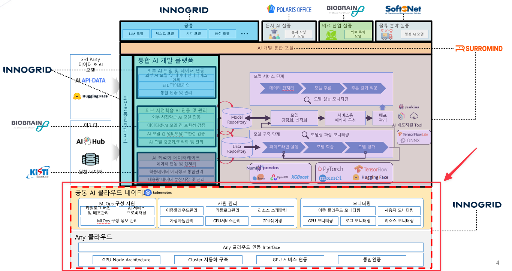
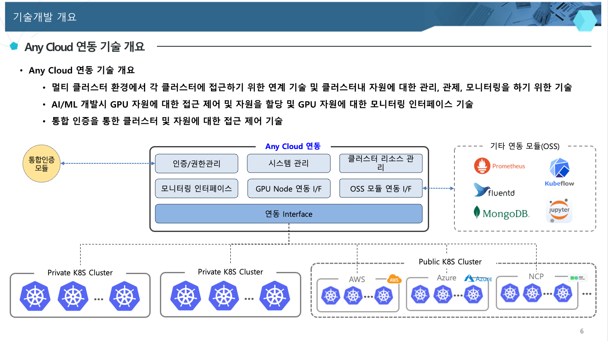
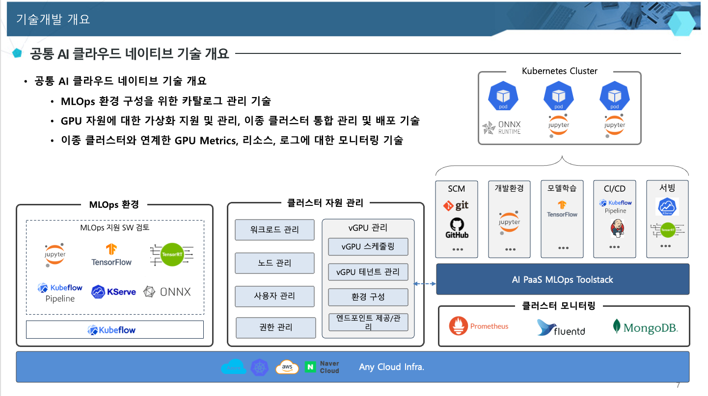

# any-cloud-management

멀티 클러스터 자원 관리, 관제, 모니터링을 위한 멀티 클라우드 관리 플랫폼





## 주요 특징

- **멀티 CSP 7종 지원**: AWS, GCP, Alibaba, OCI, OpenStack, Proxmox, IBM
- **VM → kubeadm 자동화**: Pulumi YAML 프로그램이 VM, 네트워크, 보안그룹, IAM 을 만들고 Bootstrap Worker 가 kubeadm init/join 과 CNI, Ingress, GPU Operator 설치까지 이어서 수행합니다
- **RabbitMQ 단계형 워크플로우**: `provision → bootstrap → verify → ready` (DLQ 포함), at-least-once 멱등성 가드 적용
- **Self-hosted 친화**: state backend RustFS(S3 호환), secrets OpenBao(Vault 호환). 외부 SaaS 의존 없음
- **운영용 기능**: Flyway 자동 마이그레이션, 도메인별 비동기 풀, 토큰 기반 인증 toggle
- **관측성**: 모든 워크플로우 메시지의 PROCESSED / SKIPPED_* / FAILED 결과를 `workflow_message_log` 에 영속화

## 빠른 시작 (로컬)

```bash
# 0. (한 번만) git pre-commit hook 등록. Spotless, Buf lint 를 자동 검증합니다
make hooks-install

# 1. 첫 setup. .env 생성, random secret 주입, dev stack 기동까지 한 번에
make bootstrap-dev          # ~3-5 min (cold), idempotent
# 또는 수동:
#   cp .env.sample .env  &&  편집
#   make dev-up              # docker-compose.dev.yml 의 full stack
#   make secrets-warn        # dev default 사용 여부 확인

# 2. OpenBao transit secrets engine 활성화 (secrets-provider=hashivault 사용 시)
docker compose -f docker-compose.dev.yml exec openbao bao secrets enable transit
docker compose -f docker-compose.dev.yml exec openbao bao write -f transit/keys/anycloud-pulumi

# 3. Swagger UI
open http://localhost:8888/docs

# 4. (선택) PoC 테스트 콘솔. 4탭 단일 페이지이고 운영 포털은 따로 있습니다
open http://localhost:8888/test-console/index.html
```

기본 secrets-provider 는 `passphrase` (환경변수 `PULUMI_PASSPHRASE` 만 필요).
OpenBao 모드로 전환하려면 `PULUMI_SECRETS_PROVIDER=hashivault://openbao:8200/anycloud-pulumi` override.

> [`docs/README.md`](./docs/README.md) 문서 참고

## 빌드 / 검증 방법

| 명령 | 설명 |
|---|---|
| `make backend-build` | Spring Boot 컴파일 |
| `make backend-test` | 전체 테스트 (unit + integration) |
| `make test-unit` | 단위 테스트만. Testcontainers 를 띄우지 않습니다 |
| `make test-integration` | 통합 테스트만. mariadb, rabbitmq 가 필요합니다 |
| `make test-coverage` | jacoco HTML 리포트 생성 후 자동으로 엽니다 |
| `make format` | `spotlessApply` (Palantir Java Format) |
| `make format-check` | `spotlessCheck`. CI 와 같은 검사입니다 |
| `make proto-lint` | `buf lint` |
| `make all-build` | backend, pulumi, agent 전체 |

## API

모든 endpoint 는 `/v1/` prefix 입니다. 전체 목록은 [`docs/api/v1-reference.md`](./docs/api/v1-reference.md) 에 있고, 실행 중인 서버에서는 `/docs` (Swagger UI) 로 볼 수 있습니다.

응답 envelope 는 성공이 `{success, status, message, data, meta?, links?}`, 에러가 `{code, status, message, errors[]}` 입니다. 비동기 작업은 202 와 함께 Operation 자원을 돌려주고 `Location` 헤더에 `/v1/operations/{id}` 가 담깁니다.

### 운영 토글

환경별로 덮어쓰는 property 와 Caffeine cache, ShedLock 표는 [`v1-reference.md`](./docs/api/v1-reference.md#운영-properties) 에 있습니다.

`csp-credential.encryption-key` 는 MANUAL 자격증명을 쓸 때 반드시 채워야 합니다. 비어 있으면 부팅이 실패합니다.

## 문서

전체 문서 색인: [`docs/README.md`](./docs/README.md)

| 카테고리 | 내용 |
|---|---|
| [`docs/architecture/`](./docs/architecture/) | 시스템 설계, 런타임 구조, Pulumi / Starter / Design |
| [`docs/api/`](./docs/api/) | 외부 노출 API 명세 (v1 reference, webhook 등) |
| [`docs/conventions/`](./docs/conventions/) | 개발 표준 (DTO naming, DB migration, 주석 스타일, 용어) |
| [`docs/operations/`](./docs/operations/) | Quickstart, Day-2 운영, monitoring, E2E 체크리스트 |
| [`docs/runbooks/`](./docs/runbooks/) | 트러블슈팅 / 운영 절차 (cluster-agent 6종) |

## 릴리스

`v*.*.*` 태그를 푸시하면 GitHub Actions 가 아래를 발행합니다.

| 워크플로 | 산출물 |
|---|---|
| Publish Backend Image | `ghcr.io/ai-paas/anycloud-backend` (amd64, arm64) |
| Publish Agent Images | cluster-agent, backup-agent |
| Publish Ops Shell Image | 운영용 디버그 셸 |
| Publish Starter Jars | starter 3종을 GHCR Maven 으로 |
| Publish OpenAPI Spec | `openapi/{tag}/openapi.json` 을 gh-pages 로 |

운영 배포는 `docker-compose.yml` 이 그 이미지를 받아 씁니다. `ANYCLOUD_BACKEND_IMAGE_TAG` 를 비우면 `latest` 입니다.

```bash
make prod-up
```

## 구성

| 디렉터리 / 파일 | 설명 |
|---|---|
| `apps/anycloud/` | Spring Boot 백엔드 (Java 21) |
| `apps/agent/` | Cluster Agent (Go, in-cluster) |
| `libs/cluster-agent-spring-boot-starter/` | **Layer 1**: gRPC reverse-tunnel, 인증, PodExec WebSocket |
| `libs/cluster-agent-features-spring-boot-starter/` | **Layer 2**: RBAC, Backup, Observability 를 한 artifact 로 묶음 |
| `libs/cluster-provisioning-spring-boot-starter/` | Pulumi 기반 multi-CSP VM 인프라 orchestration. provider 별 `*YamlEmitter` 가 Pulumi YAML 프로그램을 만듭니다 |
| `infra/helm/` | Helm 차트, binary 번들 |
| `libs/cluster-agent-spring-boot-starter/src/main/proto/` | 공유 protobuf 스키마 (Java + Go generate). 생성물은 gitignore |
| `docker-compose.dev.yml` | MariaDB + RabbitMQ + ChartMuseum + RustFS + OpenBao + backend + worker 통합 dev compose (`make dev-up`) |
| `docker-compose.yml` | GHCR 이미지만 받아 쓰는 운영 구성 (`make prod-up`) |
| `Dockerfile.pulumi` | Pulumi CLI 포함 backend 이미지 |
